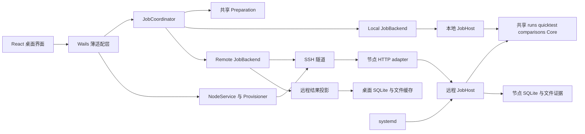

# 多服务器远程执行改造方案

状态：分阶段实施中。日期：2026-10-15。源码基线：`62635ba28ae22f0e91d6887a291ee81844d2fdfd`。

沿用现有 Go Core、协议运行时、负载调度、用例判定和报告计算。在上层增加任务提交与节点管理，让同一份准备完成的任务可以交给本地或远程 JobHost 执行。远程 JobHost 由服务器上的 systemd 托管，独立保存任务和结果；桌面退出只断开观察连接。

首轮完整覆盖多服务器配置、runner 自动部署和保活、选择节点执行、桌面退出后任务继续，以及重连后的结果恢复。每个任务绑定一个执行位置；同一节点承接完整任务及其子运行。跨节点拆分一个压测、账号同步和中央共享 Worker 池属于独立扩展，不是本方案的前置依赖。

## 现有基础与改造边界

历史规划已经要求[共享领域协议](../../todos.md)、关闭客户端后继续运行、复用执行包和报告格式。现有实现具备以下基础，但尚未形成远程任务服务。

| 现有位置 | 已有能力 | 本次处理 |
| --- | --- | --- |
| [runs/service.go](../../internal/application/runs/service.go) | Executor 注入、快照准备、逐条目执行、取消、结果落盘和终态报告 | 分离准备与执行，增加接收已准备快照的入口，保留实际执行逻辑 |
| [runs/quick_task.go](../../internal/application/runs/quick_task.go) | Suite 输入绑定、临时或已保存渠道、凭据解析 | 抽出准备阶段；远程运行不再回查桌面目录或凭据引用 |
| [runs/protocol_executor.go](../../internal/application/runs/protocol_executor.go) | 协议调用、预热、调度和判定 | 原样复用主要执行路径 |
| [quicktest/service.go](../../internal/application/quicktest/service.go) | Quick Performance 的预热、爬坡、容量探索、时间切片和归档 | 分离连接解析与执行；保留这些阶段的计算实现 |
| [comparisons/service.go](../../internal/application/comparisons/service.go) | 同模型多渠道校验、准备子 Run、统一激活和结果汇总 | 整组准备并提交到同一节点；汇总由节点推进 |
| [RunSnapshot](../../internal/domain/run_snapshot.go) | 冻结完整 Plan、映射、Case 定义、输入和负载 | 增加明确的执行来源，不在远程读取“最新用例” |
| [EnvironmentSnapshot](../../internal/domain/report.go) | OS、架构、地区、出口、应用和引擎版本 | 补充稳定节点身份与执行构建标识 |
| [SQLite 执行仓库](../../internal/persistence/sqlite/repository_execution.go) | Run revision、结果、证据校验、事务 | 增加任务日志及远程投影的原子写入边界 |
| [生产装配](../../apps/desktop/production.go) | 本机执行器、Quick Performance 服务、凭据与仓库注入 | 装配 Coordinator、本地 JobHost、远程客户端与节点服务 |
| [恢复逻辑](../../internal/application/runs/recovery.go) | 把上次进程留下的活动 Run 标为取消 | 只恢复本执行宿主拥有的任务；远程镜像不进入该逻辑 |
| [CLI audit](../../cmd/llm-test-studio/main.go) 与 [CLI load](../../cmd/llm-test-studio/load_command.go) | 复用应用或引擎能力，本地命令式执行 | 不把 CLI 子进程充当常驻 runner；受影响的共享类型同步更新 |

需要特别区分：当前 `ExecutionRequest` 含 `*credentials.Lease`、停止 channel 和结果回调，是进程内端口，不能直接序列化为远程协议。当前 CLI 也没有与桌面所有入口共用同一个持久任务生命周期。

## 目标架构与数据所有权

本地与远程使用同一个 JobHost 实现，分别装配在桌面进程与独立 runner 中。Local JobBackend 是进程内调用，Remote JobBackend 是通信实现；它们代表当前支持的执行位置，不是历史版本的双实现。

| 数据 | 权威写入方 | 桌面行为 |
| --- | --- | --- |
| 模型、渠道、Case、Suite、Plan | 现有文件目录与应用服务 | 继续编辑；提交时冻结所需定义 |
| 节点配置与 SSH 凭据引用 | 桌面 NodeService | 保存于用户配置目录；秘密进入 OS 安全存储 |
| 本地任务的状态和结果 | 本地 JobHost | 直接查询现有仓库 |
| 远程任务的状态、结果、报告和证据 | 所选节点 JobHost | 持久化只读镜像，按节点日志补齐 |
| 网络可达性、最后同步时间、待送达命令 | 桌面连接与同步服务 | 独立于 Run 状态展示 |

只有执行宿主推进任务生命周期。桌面失联不得把远程 Run 改为 failed 或 cancelled。远程报告保留原始 ID、revision、时间、节点身份和指标；下载完成后可离线查看与导出。桌面不根据下载耗时重算性能指标。

## 模块和接口调整

以下为拟新增模块，具体文件可按现有包大小拆分；依赖方向必须保持 adapter → application → domain。

| 模块 | 职责 |
| --- | --- |
| `runs.Preparer` 与性能准备组件 | 从现有准备函数提取目录解析、协议校验、输入绑定、连接解析和快照冻结；以只读端口工作，返回准备值与单独的秘密 lease，避免为移动目录新增相互依赖 |
| `internal/jobcontract` | 单一当前 JobSpec、事件和错误的传输契约；复用 runs、quicktest 和 comparisons 的当前准备值，不导入 SSH、Wails 或数据库 |
| `internal/application/jobs` | 选择 Backend、持久化提交记录、提交或重查同一 job_id、路由操作；不调度请求 |
| `internal/application/jobhost` | 接收完整任务、排队、资源预算、调用已有 Core、持有取消上下文、结果日志和恢复 |
| `internal/application/remotenodes` | 节点配置、状态查询、安装操作编排与构建核对 |
| `internal/remote/ssh` | 主机密钥验证、SSH 认证、SFTP、隧道与固定安装命令执行 |
| `internal/remote/client` | 实现 Remote JobBackend 和游标同步；不包含业务判定 |
| `internal/adapters/runnerhttp` | 有界 HTTP 解码、鉴权、契约验证和错误映射 |
| `cmd/llm-test-runner` | 无 Wails 依赖的常驻入口、配置装配、systemd readiness 和 watchdog |
| `internal/persistence/sqlite` | 复用现有执行表；补充任务、日志、提交记录、命令与镜像同步的逻辑记录 |

`JobBackend` 的语义操作统一为 `Submit`、`GetJob`、`ListJobs`、`ReadEvents`、`StopSending`、`Cancel`、`GetReport`、`ReadArtifact`。这些接口使用明确的值对象和流式内容，不承载 Go channel、函数或 Lease。Local Backend 同样经过当前契约校验，但不需要编码再解码 JSON。

### 准备与执行分开

1. 把 `PrepareTarget`、`PrepareQuickTask` 的解析规则移入 Preparation，原调用方改为 Coordinator；不保留只为旧调用方服务的包装入口。
2. 准备阶段生成稳定 job_id、run_id、comparison_id、report_id，解析所有子任务；输出中不保留“执行时去桌面查询”的引用。
3. Job 仓库在接收事务中创建 queued Run；`runs.Host.AdoptQueued` 只接管已经持久化的初始 Run，再复用 `executeEntries`、ProtocolExecutor、summary 与 report generator。其执行仓库端口不承担创建或目录查询。本地单 Run 的准备 facade 在接入 Coordinator 前负责创建与注册，共用宿主的生命周期锁。
4. Quick Performance 抽出地址、渠道、任务来源和预算准备，执行阶段接收 PreparedPerformance 与 lease。保留当前工作负载生成、随机种子、SLO、容量探索和报告模型，不强行转换成 Case Run。
5. 对比任务先冻结所有子 Run；节点在一次接收事务中保存完整组，再按现有激活策略执行。子任务结束后，宿主调用现有汇总规则推进 Comparison，不依赖桌面刷新。
6. 所有输入与边界校验在准备和节点接收处执行；同一业务规则复用同一函数，不在 HTTP adapter 另写一份。

JobSpec 使用固定的 `run`、`performance`、`comparison` 三种当前任务类型。它们对应现有产品能力，不按 schema_version 选择历史执行器。每种只允许自己的一个 payload。Job 不重定义测试结论：Run 与 Comparison 的执行状态由原领域对象产生，Job 状态是其调度和终态投影；无 Run 的 Performance 由 JobHost 持有执行状态，测试成功与否仍来自 PerformanceReport。

Performance 类型的 Plan 在准备时进入 PreparedPerformance 路径，不交给当前明确拒绝 `plan.Performance` 的 `runs.PrepareTarget`。Performance 执行入口同时接收宿主持有的停止发送信号，接入已有 load scheduler 的 drain 能力，避免只有 Case Run 支持该操作。

### 桌面入口一起更新

Plan 启动、Suite 快速任务、Quick Performance 和对比入口均增加必填的 ExecutionTarget。值为 `local` 或带 node_id 的 `remote`，多余组合与缺失值明确拒绝。位置属于本次启动配置，不固化到可复用 Plan。

Quick Performance 的长时间同步 binding 改为启动并返回 JobReceipt，界面通过统一任务事件取得进度与最终报告。同步更新 `apps/desktop/quick_performance.go`、`app.go`、生产装配、`desktop-client.ts`、DTO 解析器、调用组件、测试和生成 bindings，移除受影响的旧入口。Wails 固定保持 v2.15.0；生成命令先核对 CLI，不手改生成文件。

用户指定在运行页顶部“渠道对比 / 新建运行”旁增加 Remote 按钮，集中配置和管理节点，并支持切换执行位置、将某个远程节点设为默认。默认位置由 Go Core 保存，重开应用后保留，作为 Plan、Suite、Performance 和 Comparison 新启动任务的初始选择；每次提交仍显式携带 ExecutionTarget。首次未配置时为本地，之后尊重已保存的默认位置。默认节点离线、禁用、协议不支持或缺少任务所需能力时保留选择并说明不可用原因、阻止启动，不自动改成本地。已接收任务的执行位置不随默认设置变化。

既有 CLI 本地命令的语义保持当前产品契约；若调用受影响类型，命令适配层显式构造 local。远程 CLI 命令可直接消费同一 Backend，首轮不以重构全部 CLI 输出为前置工作。

## 节点配置与连接

节点非秘密配置保存到用户配置目录内独立的 `nodes.json`，采用单一当前格式、稳定 UUID、revision、原子文件写入和并发修改检测。它属于本机运行环境，不混入模型与渠道 authored 文件。配置只保存以下信息：

- 显示名称、SSH host、port、user、启用状态和用户填写的地区说明。
- SSH 认证方式及 CredentialRef，支持密码或私钥与口令；私钥通过 Go 文件选择与安全存储处理。
- 已核验的 SSH 主机公钥指纹及 key type、配对后的 runner installation_id、runner 管理凭据引用。固定 key type 后只协商对应的安全签名算法，避免同一服务器的其他公钥被误报为已确认密钥变化；RSA 只使用 SHA-2 签名。
- 节点资源策略；探测到的架构、runner 版本、实际构建、当前契约、能力、出口和最后检查时间作为运行观察信息。连接动作不覆盖节点策略。

同一用户配置内 installation_id 唯一；不同主机别名连接到同一安装时提示已有节点，不能把同一执行宿主计为两台服务器。

新增 SSH 认证与 runner 管理专用 CredentialPurpose，复用当前 scoped OS Store；不借用 Channel API Key 用途。读取 DTO 仅返回认证方式、是否已设置和指纹等脱敏信息。首次连接需要用户核对主机指纹，后续指纹变化直接阻止连接；不得使用跳过主机验证的实现。

通信采用 SSH direct-tcpip 到节点的 loopback HTTP 服务，客户端无需开放本地监听端口，runner 不监听公网。SSH 建连、SFTP 与请求有独立超时；隧道断开后释放客户端资源，不向任务发送取消。runner HTTP 使用节点级 token，多个熟人客户端共用同一节点授权，不增加客户端注册、独立身份或逐客户端授权表。各桌面将共享 token 保存于 OS Store，runner 配置仅保存校验摘要。安装器在 `/var/lib/llm-test-runner-install/node-token` 保存 root 专有的配对授权，供已获 SSH 管理权的其他客户端读取并存入各自 OS Store；该目录为 0700、文件为 0600，不归 runner 用户读取。令牌不进入 URL、参数列表或日志。接入已有节点不轮换 token；配对文件缺失时明确要求修复授权，不覆盖已有 runner。持有节点授权的客户端可查询和控制节点任务。

保存节点即触发检查；未安装时自动部署，已安装且契约和能力满足时直接复用。协议或能力不满足时提示需要升级，不因客户端连接而替换 runner。配置存在、连接可达、部署成功、契约与能力满足、容量可用分别记录，Go Core 据此返回是否可选与不可选原因。离线节点保留历史记录；移除配置不等于卸载 runner。存在活动任务、未确认提交或未下载结果时阻止移除配置，用户可先禁用新任务。

### 多客户端共享与并发

同一服务器的客户端连接同一个常驻 runner、同一份节点任务库和同一套资源预算。runner 返回共享的 node_id 与 installation_id；不同桌面的显示名称、SSH 别名和本地默认设置不改变节点身份。客户端不因接入而各启动一个 runner，也不分配独立的节点并发额度。

不同 job_id 进入节点统一 FIFO 队列，runner 根据活动 Job 数与所有活动 Job 的总并发预算调度；默认一次执行一个 Job，允许显式调整为多个。单个任务内部的请求并发、Comparison 子 Run 并行与同时运行的 Job 数是不同层级，不能把每个客户端的额度相加后绕过节点预算。相同 job_id 的重传按持久幂等记录返回原任务；改内容或秘密拒绝。客户端断线或退出不释放已接收任务，也不重置队列或预算。

安装和升级持有服务器端、所有客户端共享的安装锁；取得锁后重新检查状态，避免另一个客户端已完成安装时再次覆盖。runner 另持有状态目录的单实例进程锁，阻止两个进程同时调度同一任务库。锁不按桌面实例划分。

升级先取得安装锁并使节点暂停接收新任务，再等待全部 Pending 归零、保存备份并切换程序；Pending 包含已取消但仍在生成报告或释放资源的任务。失败时恢复可诊断状态。不能仅检查一次“当前空闲”后继续接收提交，否则另一个客户端可能在检查和停机之间创建任务。安装、升级和重启均不按客户端版本自动触发。

维护门由当前 installation 的私有 maintenance.json 持久化，pause/resume 使用同一 operation_id；不同操作不能解除当前暂停。健康与可接收分开，暂停仍继续 watchdog 和已接收任务。重复确认限当前维护记录；安装器必须在共享安装锁内以安装日志识别已完成历史操作，不得把旧 pause 当作新的安装重放。写确认丢失须核对记录并重新同步文件和目录；仅能回读内容不代表落盘成功，无法确认时隔离接收。

## runner 自动部署与保活

### 支持平台与交付物

首轮支持有 SSH、SFTP 和 systemd 249 及以上的 Linux amd64、arm64 服务器，安装账户需为 root 或具备约定安装操作的免交互 sudo。平台不满足时给出具体检查结果，不自动切换 nohup、Docker 或临时前台进程。服务器无需 Go、Node、Wails 或桌面环境。

在现有 [release workflow](../../.github/workflows/release.yml) 增加独立 runner 构建 job，产出 Linux 两种架构的二进制、SHA-256 清单和构建 manifest。runner 的 engine_build_id 绑定其精确源码与依赖；各架构文件另有自己的 SHA-256。桌面从用户选择的发布获取并缓存二进制，再上传到服务器，服务器无需访问 GitHub。开发构建同样携带明确 build_id，不把所有 `dev` 当成相同构建。客户端自身的发布版本或构建不要求与 runner 相同。

提交前核对双方支持同一个当前管理契约和任务格式，且 runner 具备任务要求的协议、负载阶段与报告能力；满足即允许不同发布版本和构建的客户端使用节点。不支持时明确提示升级及缺少的能力，不协商历史格式、不降级解码，也不在运行时保留多版自有契约。

任务 engine_build_id 由探测到的实际 runner 填入，表示本次预期执行环境，不是客户端自己的构建。runner 接收时仍核对该值，防止探测后节点被升级；变化时重新探测并准备同一尚未接收的任务，不自动覆盖 runner。报告记录实际 runner 版本与构建。此处替换“客户端和 runner 必须精确同构建”的方案约束；字段校验和 Host 构建核对保留其执行环境身份含义。管理面已提供能力探测与节点级授权，安装器已使用共享安装锁；桌面选择与执行链路仍待接入。

### 安装流程

1. **检查**：取得节点安装锁，重新验证主机身份、架构、systemd、权限、可用磁盘、已有 runner 和安装路径归属；兼容的已有安装直接复用。
2. **准备**：取得精确构建的交付物并本地校验摘要；通过 SFTP 上传临时文件，节点再次校验。
3. **安装**：建立专用无登录执行用户、根所有的版本目录、配置和服务 unit；状态目录与程序目录分离。
4. **启用**：原子选择 current 程序，执行 daemon-reload 与 enable/start；安装步骤可按 operation_id 重查和重复执行。
5. **验证**：核对 systemd 服务身份、实际进程构建、installation_id、鉴权、数据库可写和控制接口；不以进程存在或端口监听作为部署成功。
6. **回读**：保存已确认身份和安装结果，节点进入可选状态；失败保留阶段与脱敏诊断，允许重试同一安装操作。

程序位于 `/opt/llm-test-runner/releases/<build_id>/`，`current` 原子选择发布；运行配置为 `/var/lib/llm-test-runner/runner.json`，状态与证据同在该专用用户的 0700 状态目录内。安装操作日志与配对授权位于 root 专有的 `/var/lib/llm-test-runner-install/`。这与当前 systemd unit 的路径一致，替换方案早先的 studio-runner 路径，不保留路径回退。安装器只操作这些核验后的自有路径；用户输入不直接拼接成 shell 命令。修改账户、unit 和 current 使用固定安装模板与受限参数。

服务使用 `Type=notify`、`Restart=on-failure`、`RestartSec=5s`、`WatchdogSec=30s`，并设置 300 秒内最多 5 次启动的限速。runner 在状态存储和接收恢复完成后发送 READY，watchdog 反映调度和存储控制面的健康；阻塞的上游请求由各自超时管理。服务使用专用用户、私有状态目录、`NoNewPrivileges`、`LimitCORE=0`、只读程序目录，并配置资源上限。systemd 的重启与 watchdog 行为依据[官方 service 文档](https://raw.githubusercontent.com/systemd/systemd/main/man/systemd.service.xml)，持久目录与权限依据[官方 exec 文档](https://raw.githubusercontent.com/systemd/systemd/main/man/systemd.exec.xml)，查阅日期为 2026-10-15。

桌面打开时每 15 秒探测节点，45 秒无成功响应标为连接不可达；桌面关闭后 systemd 仍负责保活。连续启动失败达到限速后展示异常与修复操作，不反复重装或删除数据库。更新、重启和卸载先检查活动任务；普通更新等待全部任务终态并保存一致性备份，再切换构建。健康验证失败时，只有数据库仍满足旧程序的精确当前格式才可切回旧程序；已发生格式转换时恢复匹配的备份，不能用旧程序打开新数据。

## 完整任务的接收与执行

### 当前提交契约

Submission 包含以下完整字段组；解码拒绝未知字段、未知枚举和不支持的当前格式标记。

| 字段 | 含义与约束 |
| --- | --- |
| `contract` | 当前唯一 runner 契约标记，初次定义为 1；缺失或其他值拒绝 |
| `job_id` | 客户端预分配的规范 UUID，是提交幂等键 |
| `node_installation_id` | 配对时确认的节点安装身份；重装换身份后拒绝旧提交 |
| `engine_build_id` | 由节点探测值填入并核对实际 runner 构建；不要求等于客户端构建 |
| `kind` 与 `spec` | 当前三种类型之一及对应完整 Prepared payload，恰好一个 |
| `assets` | 内容摘要、大小、媒体类型、逻辑引用；不得包含任意远程写入路径 |
| `secrets` | 按 slot 对应任务所需凭据的临时传输字段；不属于持久化 spec |

Run payload 复用完整 RunSnapshot 与预分配 Run ID；Performance payload 保存解析后的端点、模型、协议、负载、随机种子、来源快照和 Report ID，消除 ChannelID、CredentialRunID 与 TaskPath 的运行时桌面依赖；Comparison payload 保存整组 PreparedRun、子 ID 和不同渠道的秘密 slot。

节点接收时核对自身环境，并在构造最终不可变 Run 前冻结真实环境和执行来源。准备时探测的身份或构建若发生变化，拒绝本次提交并要求重新准备，不悄悄更换环境。规格、配置标签与实测出口分开保存，实测失败明确记录未知，不能把标签当成实测。

### 提交时序与确认丢失

1. 桌面先保存不含秘密的 submission outbox：job_id、节点身份、PreparedJob、摘要和提交状态。
2. 上传必需 asset，节点验证内容摘要后才能引用。桌面仅在提交期间持有当前任务所需的 lease。
3. 节点校验完整契约、能力、资源、asset 和 secret slot；事务内保存 Job、所有初始领域对象与 accepted 日志，提交后才允许发出第一条上游请求。接受前申请的内存队列槽与 lease 在接受成功时移交宿主；执行上下文来自宿主，不继承 HTTP request context，响应写出失败也不释放已接收任务的秘密。
4. 节点返回 JobReceipt；桌面保存确认并释放自己的秘密。之后所有 Suite 条目、预热、容量阶段和对比子 Run 由节点独立推进。
5. 相同 job_id 与相同规范化 spec、asset、凭据承诺返回原确认；任何差异返回冲突。凭据承诺由节点专用密钥计算 HMAC，落盘仅保存承诺。
6. HTTP 确认丢失时重查同一节点的同一 job_id；仍持有提交材料时可重传同一提交。不得分配新 ID 或换节点自动重试。
7. 桌面崩溃后重启先查询 outbox。节点确认不存在且 installation_id 未变时展示未提交；节点不可达时保持提交待确认；身份改变时要求人工处理。缺少临时秘密时不自动补交。

同一 job_id 在节点最多启动一个调度实例，不宣称外部提供商请求恰好执行一次：请求发出后进程崩溃，外部是否已处理可能未知。节点重新启动会把旧宿主遗留的 queued、starting、running、draining 作业封为 failed，错误为 `runner_interrupted`，保留已落盘证据，不恢复或重放其计费请求。重新测试必须是用户明确发起的新任务。

任务凭据在节点仅保存于受限生命周期的内存 lease，直到终态或队列等待超时后清理；不落盘到任务、事件、报告或普通日志，不配置 core dump。重启后不依赖找回这些秘密续跑。服务器管理员仍处于受信任边界，任务提交界面明确显示凭据会临时用于所选节点。

### 任务预算

节点默认同时执行 1 个 Job、等待队列最多 16 个 Job、队列等待上限 15 分钟、单 Job 执行含 drain 上限 60 分钟。运行时限允许节点显式配置到最多 24 小时；节点还限制总并发、磁盘预算和存储保留量。Comparison 的子 Run 合计占用一个 Job 的总并发预算。

当前默认总在途预算为 2000，来自 Core 的 open-loop 安全上限。预算计算使用 Run 内顺序 Entry 的最大阶段峰值，包含 warmup；Comparison 则累加各子 Run 峰值。Run open-loop 的实际默认上限并非 authored concurrency，不能用后者低估资源。Performance 使用自己的固定并发或显式 MaxInFlight。策略必须显式有效：活动槽 1 至 128、排队槽 0 至 1024、总并发 1 至 65536、两个超时大于 0 且最多 24 小时；节点默认值不代表本地装配策略。

这些是远程节点的默认预算；本地 JobHost 注入既有本地执行策略，不因复用宿主而把当前本地任务统一串行为单 Job。

所有现有协议与负载限制继续由 Core 校验，节点限制取其与 Core 上限中更严格者。超过预算在接收时拒绝，不暗中降低请求数、并发或输出长度；不能静态推导的执行时间由宿主截止时间限制。磁盘满或持久化失败立即停止发送并保留故障状态，禁止继续生成无法记录的测试结果。

## 节点控制接口与边界

HTTP 仅通过 SSH 隧道访问。所有请求携带节点级 Authorization；JSON 接口使用当前契约头，解码前核对该契约，接收任务时核对预期 runner 身份与所需能力，不比较客户端构建。以下路径不是历史版本选择器。

| 方法与路径 | 当前语义 | 主要返回 |
| --- | --- | --- |
| `GET /runner` | 探测安装身份、构建、平台、能力和预算 | 200 当前元数据；契约不匹配返回 426 |
| `POST /runner/maintenance` | 当前 operation_id 的 pause/resume；暂停接收，保留执行和报告收尾 | 200 当前维护确认及状态；不同操作争用 409；新任务暂停时 423 |
| `PUT /assets/{sha256}` | 上传原始字节，校验长度和摘要，原子完成 | 201 新 asset；200 已有同内容；422 摘要不符 |
| `POST /jobs` | 完整接收并持久化任务 | 202 新 JobReceipt；200 同一提交；409 ID 内容冲突 |
| `GET /jobs?after=&limit=` | 按稳定接收序列分页，重找已接受但本地未确认的任务 | 200 Job 摘要及 next_cursor |
| `GET /jobs/{id}` | 权威状态、revision、进度、子运行、最新 sequence、报告引用 | 200；404 未找到 |
| `GET /jobs/{id}/events?after_sequence=&limit=&wait_ms=` | 按序读取持久化事件，可长轮询 | 200 事件页，超时返回空页而非失败 |
| `POST /jobs/{id}/stop-sending` | 持久化 command_id，停止新请求并等待在途完成 | 200 当前确认；409 非法状态或 revision 冲突 |
| `POST /jobs/{id}/cancel` | 持久化 command_id 并执行取消 | 200 当前确认；409 已终态且并非该命令的重传 |
| `GET /jobs/{id}/reports/{report_id}` | 当前格式的 Run 或 Performance 报告 | 200 带类型的报告及摘要 |
| `GET /jobs/{id}/artifacts/{artifact_id}` | 流式读取该 Job 的脱敏证据，支持 Range 与摘要校验 | 200 或 206；416 越界 |
| `POST /jobs/{id}/release` | 仅终态且有完整下载回执时回收大文件，保留幂等墓碑 | 200；409 活动或未完整保存 |

身份或权限错误使用 401/403；JSON 类型、必填、组合和当前 spec 校验错误使用 400；管理契约缺失或不支持使用 426；任务所需能力缺失或 asset 摘要不符使用 422；ID、revision、安装身份或预期 runner 构建冲突使用 409；Content-Type 错误使用 415；请求体过大使用 413；容量或队列已满使用 429；存储不可用使用 503。错误统一返回当前 envelope 中的 `code`、安全 `message`、可选 `field` 和 `retryable`；禁止返回秘密和原始内部异常。`retryable` 只指同一管理操作，不授权新建测试。

边界定义如下，数值是本方案默认值，不是对现有提供商限额的描述：

| 参数 | 接受范围或规则 | 必须拒绝的类别 |
| --- | --- | --- |
| SSH port | 整数 1 至 65535 | 0、65536、字符串、负数 |
| node name | 去除首尾空白后 1 至 80 个 Unicode 字符 | 空、超长、控制字符 |
| UUID 与摘要 | 规范 UUID；64 位小写十六进制 SHA-256 | 缺失、错长、非规范、错误字符 |
| ExecutionTarget | local 无 node_id；remote 必须有已配置 node_id | 缺失、未知 kind、交叉组合、未知节点 |
| `kind/spec/secrets` | 一个当前 payload；slot 集合与所需凭据一一对应 | 多 payload、缺 slot、多 slot、空秘密 |
| JSON 提交大小 | 最多 8 MiB；秘密最多 32 个，每个最多 8 KiB | 超限返回 413，asset 不内联到提交 |
| asset | 单文件 1 byte 至 1 GiB、每 Job 总量最多 4 GiB、最多 128 个；没有媒体时列表为空 | 零字节、超限、摘要不符、引用缺失、路径穿越 |
| 分页 | limit 必填，整数 1 至 200；不透明 cursor 绑定安装身份 | 0、201、负数、其他安装的 cursor |
| 事件游标 | after_sequence 为 0 或已有持久序号，wait_ms 为 0 至 20000 | 负数、未来序号、越界等待、其他 Job 游标 |
| 操作命令 | command_id 规范 UUID，expected_revision 为当前 revision | 相同命令 ID 改内容、对终态提交新操作 |

现有 `MaxReportProjectionItemBytes` 与 Performance 报告 32 MiB 存储上限继续生效；大报告采用独立下载，不混入事件页。Case 定义、原生请求、模型映射和负载字段直接复用对应当前领域 validator，其既有上限不在传输层另设一套解释。长度单位、所有可选默认和错误阶段必须写入实现时的当前契约定义与表驱动测试。

JobReceipt 明确返回 contract、job_id、kind、accepted_at、node_installation_id、engine_build_id、status、revision、子 Run ID 与 Report ID 列表；Comparison 类型另外返回 comparison_id。GetJob 返回当前 receipt、最后 progress、最新 sequence、报告引用及可选稳定 failure，不能返回 secrets。事件页返回 events、last_sequence、has_more；只有已应用的事件才可推进客户端游标。`GET /jobs` 初次不传 after 表示从首个接收序列读取；事件 after_sequence 和两种分页 limit 必填，wait_ms 可省略且默认 0。Range 省略时完整下载。release 请求必须包含 command_id、expected_revision 与完整 manifest_sha256。

## 状态与故障处理

继续使用 queued、starting、running、draining、completed、failed、cancelled。提交待确认、连接离线、同步落后和报告待下载是独立展示状态，不加入 Run 状态机。completed 表示执行完成，测试通过仍由现有 verdict 与 SLA 规则决定。

| 事件 | 执行宿主行为 | 桌面行为 |
| --- | --- | --- |
| 用户关闭桌面或 SSH 断开 | 任务上下文不受影响，继续执行与落盘 | 保存游标后退出；下次启动重查 |
| 当前 HTTP 请求取消 | 只取消这次读写传输；已接收 Job 不取消 | 需要确认时重查 job_id |
| 用户停止发送 | 接收命令后进入 drain，保留在途请求 | 只有节点确认后更新执行状态 |
| 离线时用户取消 | 收到命令后执行；未收到前继续运行 | 保存同一 command_id 的待送达命令，重连重传；显示尚未确认 |
| 已完成与取消发生竞争 | 在 revision 与终态约束下只接受一个结果 | 读取权威获胜状态，不覆盖终态 |
| runner 或服务器重启 | systemd 恢复服务；旧活动任务封为 runner_interrupted | 显示中断及部分证据，不自动重跑 |
| 节点暂时不可达 | 任务可能仍在运行 | 保留最后确认状态及时间，显示连接不可达 |
| 节点被重装而身份变化 | 新安装不接管旧 Job | 阻止旧任务补交与镜像覆盖，等待明确重新配对 |
| 报告生成或下载失败 | 保存原结果；报告生成可重试但不能重发上游请求 | 显示报告状态，允许补取 |

本地 JobHost 退出仍取消其拥有的本地任务。桌面 `shutdown` 先停止观察与同步，再关闭本地 JobHost；不遍历远程 Job 发送 Cancel。启动恢复只处理本地 owner 的任务，远程投影通过节点重查恢复。

宿主关闭必须携带明确原因：本地桌面退出沿用 local cancellation；runner 在有活动任务时收到进程终止信号，先尝试保存 `runner_interrupted`，再停止其执行上下文。不能直接沿用当前 `runs.Service.Close` 的“全部标为用户取消”行为。来不及落盘的活动对象由下一次启动封为 interrupted；用户显式 Cancel 的既有终态保持不变。正常升级只在无活动及排队任务时停止服务。

## 结果日志与离线报告

持久化按下列逻辑记录划分；物理表、索引和 DDL 在实现时结合现有执行仓库验证，不在本设计生成迁移 SQL。

| 逻辑记录 | 身份与不变量 |
| --- | --- |
| 宿主 Job | job_id 唯一，绑定安装身份、类型、规范摘要、凭据承诺、预算与关联领域 ID |
| 宿主日志 | `(job_id, sequence)` 唯一，与领域写入同事务；保留单调序列 |
| 提交 outbox | 桌面 job_id 对应唯一目标节点、PreparedJob 与确认状态，不保存秘密 |
| 镜像进度 | 绑定 node_id、installation_id、job_id、已应用 sequence；与镜像同事务 |
| 控制命令 | command_id 唯一且内容固定，保存待送达或已确认结果，重传不重复操作 |
| 文件清单 | 内容摘要、大小、所属 Job、下载状态、当前引用与回收回执 |
| 执行来源 | Run 与 Performance 的不可变 owner 信息，区分本地事实与节点镜像 |

节点事件包含当前 contract、job_id、单调 sequence、UTC 时间、类型和 allow-listed payload。持久事件至少包含 accepted、state、progress、result、report、final；final 明确报告成功或失败及可取得的证据清单。progress 每秒最多落盘一次，可合并；state、结果与终态不能丢失。

日志与对应领域修改必须同事务提交：创建 Job 与所有 queued 对象、Run 状态 revision、追加结果、报告可用性各自有显式写入边界。复用 SQLite 参数化语句和事务模式；不依赖异步内存回调确保日志完整，也不引入触发器。HTTP 事件页只是已提交日志的读取。

当前 `CreateRun`、`UpdateRun`、`AppendResults` 各自开启事务，不能从接收器逐个调用来声称整组原子性。实现时将其写入逻辑提为仓库内部可组合的事务操作，由受限 UnitOfWork 完成接收与日志写入；应用层不接收裸 SQL 连接，原业务约束只保留一份。

桌面按 `(node_id, installation_id, job_id, sequence)` 投影。新增 `ApplyRemoteBatch` 事务，原子保存领域值、结果、证据索引及已应用游标；事务失败不前移游标。同 ID 同内容可重放，同 ID 不同内容报冲突，不覆盖本地执行拥有的数据。不能直接套用当前 `AppendResults` 给终态 Run 补数据，因为它要求 Run 可写；远程镜像写入使用独立端口并验证来源与日志顺序。

文件系统与 SQLite 不跨资源假装原子：下载文件先写临时路径并校验 SHA-256，再原子重命名，最后事务登记。崩溃后可清理未引用临时文件；未确认完整的文件不能标为已下载。Reference 可先记录为 pending，界面区分“元数据已同步”与“证据可离线读取”。

节点日志初期不自动压缩或删除。显式 release 需要终态与完整 manifest 下载回执，之后保留 job_id、请求摘要和终态墓碑；已释放的 Job 返回其终态及 released 标记，禁止同 ID 再执行。节点磁盘预算不足时拒绝新任务，提示同步与回收，不能删除未下载结果。

指标由节点的单调时钟测量，保留现有 E2E、TTFT、TPOT、调度 lag、预热和发送窗口口径。SSH 与结果下载延迟仅是控制面耗时。记录实际执行构建、地区、出口与时间同步状态；报告能识别节点，但不把不同节点结果未经说明合并为一组吞吐。

节点复用现有 generator 生成报告模型与 JSON；HTML、PNG、PDF 继续由桌面现有渲染与导出链路消费同步后的模型。runner 不依赖 Wails、WebView 或浏览器来完成测试和报告归档。

## 媒体与凭据处理

准备阶段建立 asset manifest，把本地图片、视频等内容映射为内容摘要，并在节点侧解析为该 Job 的受限文件引用。保持原生请求体、用例身份和断言不变；不把桌面绝对路径作为远程路径，也不自动把 URL 输入转成字节输入。

URL 型媒体保持 URL，由执行节点按现有协议运行时使用；报告记录输入模式。若用例要求特定 URL 的取回行为，保留该语义。asset 丢失、摘要不符或节点不可读时在 starting 前拒绝或明确失败，不能执行一半才隐式改用桌面下载。

重用现有 `Lease` 清理与脱敏，新增秘密传输结构仅用于受 SSH 保护的提交，解码后立即转成节点内存 lease。整个 Submission 禁止通用日志或诊断序列化；token、API key、SSH 密码与私钥均不得出现在进度事件、报告或安装命令参数。凭据变更只影响新 Job，已接收任务使用其冻结的授权。

## 桌面交互

增加“执行节点”管理页，采用现有表格、工具栏、检查器和编辑 Sheet。列表显示名称、地区、连接、runner 状态、构建及活动任务数；操作包括保存并配置、检查连接、修复或升级、禁用新任务。安装进度按检查、上传、安装、启动、验证展示，保留失败阶段与可重试入口。

所有启动面板使用共享 SearchableSelect 选择本地或某个节点。不可用项显示原因；选定远程后显示真实地区、出口、待执行配置和临时凭据用途。任务行、检查器和报告都显示执行位置。离线、待确认提交与取消待送达用独立提示，不覆盖最后权威状态。

Go Core 负责节点可选性、全部计数、生命周期、同步和部署；React 只持有选择、草稿与展示状态。中英文资源与 allow-listed DTO 同步更新。界面复用[桌面设计规范](../design/desktop-ui-system.md)，验证 1440×900、1024×768、960×640，light、dark、system、键盘、焦点恢复、长名称、空态、加载、离线和部署失败。

## 当前契约替换与历史数据

本方案会改变启动 DTO、Quick Performance 异步入口、Run 与 Performance 的执行来源字段、操作存储和事件边界。实现必须同时更新生产者、消费者、fixtures、bindings、测试与文档。只保留一个当前 runner 契约和一套当前 schema，不加入缺字段推断为 local、旧 DTO 包装、双读、协议降级或历史版本分派。

当前 RunSnapshot 标记为 1、PerformanceReport 标记为 2，SQLite 使用 `0001_protocol_runtime` 的精确结构与 checksum；这些是本设计基线，不代表下一次可以原样接受旧文件。新增必填字段后替换相应当前格式标记及校验，旧数据被原样保留并返回可操作的升级错误。新安装直接创建当前格式。

对已存在的数据库先做只读身份与结构预检，再进入当前格式的正常打开流程，确保拒绝旧格式时不因初始化、PRAGMA 或清理逻辑修改数据。

现有本地历史数据通过临时、独立调用的升级工具转换：先记录源标记与 checksum，创建一致性 SQLite 备份并复制证据清单；明确把该已知本地来源标为 local，保留 ID、时间、指标、verdict 和原始证据引用；再按目标当前 validator、行数、关联、报告摘要、foreign key 与 quick_check 验证。未知来源或格式停止，不猜测。

工具放在 `scripts/upgrade-remote-execution-once/`，仅在实施时创建并明确执行；不放入启动、构建、正常读取或远程任务接收。验证和切换完成后删除临时工具；备份保留。节点格式升级同样在无活动任务、备份完成后单独执行，不能靠重新安装清空历史数据。独立转换工具仍未创建或执行；各基础提交已改变当前 schema，不能用它们直接打开旧数据库。最终升级以 E 阶段的实际转换和恢复验证为准。

## 实施顺序与验收

| 阶段 | 修改范围与交付 | 进入下一阶段的条件 |
| --- | --- | --- |
| A 核心拆分 | 提取 Preparation，建立 PreparedJob、JobBackend 与共享 JobHost；本地入口接入 | 原有协议、负载阶段、判定和报告口径通过语义回归；无被替换的旧入口 |
| B 独立任务宿主 | runner、节点 SQLite、接收幂等、预算、生命周期、事件和控制接口 | 确认丢失、重启、取消竞争及存储故障的模拟测试通过 |
| C 节点管理与安装 | nodes 配置、专用凭据、SSH/SFTP、发布产物、systemd 安装验证 | 两种架构的干净 Linux 环境完成安装、重启和卸载边界验证 |
| D 桌面远程闭环 | 全部指定入口选节点、异步 Performance、镜像、证据及离线报告 | 两台真实节点分别执行；关闭桌面后继续，重开补齐原 Job |
| E 数据升级与交付 | 临时转换工具、文档、构建一致性检查和发布流程 | 备份恢复与转换验证完成；无运行时旧格式路径 |

阶段用于安排依赖，不缩减最终交付。只有 A 至 E 以及下列要求全部有证据后，才能宣布远程模式完成。

| 验收编号 | 场景与预期 | 所需证据与执行级别 |
| --- | --- | --- |
| R1 多服务器 | 保存至少两台节点，修改一台不影响另一台；凭据不出现在配置或 DTO | 应用服务与文件读回、OS Store stub、真实桌面操作 |
| R2 自动部署 | 干净 amd64 与 arm64 机器自动安装到精确构建，身份与鉴权回读正确 | 干净 VM 的安装阶段记录、摘要、systemd 和 HTTP 验证 |
| R3 保活 | 杀死 daemon 后服务恢复；重启服务器后自动启动；启动失败限速可诊断 | 真实 systemd 的 PID、boot、重启计数、状态与事件 |
| R4 节点执行 | 同一冻结输入在本地和两个节点执行，目标端看到对应出口 | 可控 Mock 的请求、节点身份、运行快照；不依靠 UI 标签证明 |
| R5 桌面退出 | 任务含多个 Suite；第一条目期间关闭桌面，后续条目仍完成 | 节点日志、Mock 请求与桌面重新打开后同 ID 的报告 |
| R6 全入口 | Plan、Suite 快速任务、Performance 含 warmup/ramp/capacity、Comparison 均可远程；其已提交后续阶段不依赖 UI | 各入口离线持续运行证据，保留现有类型各自的判定与报告 |
| R7 提交幂等 | 模拟提交落盘后断响应，重传相同 job_id；只启动一次；改内容或秘密拒绝 | 持久日志、调度实例计数、Mock 请求预算；不声称外部 exactly-once |
| R8 故障恢复 | runner 重启后旧任务为 interrupted，未重发请求；网络失联不改终态 | 故障注入、重启读回、节点身份变化和请求计数 |
| R9 结果恢复 | 重复页、断页、落盘失败、终态晚到、文件下载中断均可重试，游标不越过未提交数据 | 事务回滚与投影测试、文件 hash、离线报告 JSON 对照 |
| R10 操作状态 | queued/running/draining/terminal 下停止与取消决策表；离线命令待确认，竞争保持唯一终态 | 表驱动测试与真实节点重连测试 |
| R11 输入边界 | 契约表所有字段的有效、无效、上下界、互斥和状态组合，包括 0/1/N/N+1 与字节长度 | 本地 HTTP 契约矩阵；每项明确接收拒绝或接收后终态失败 |
| R12 媒体与安全 | 本地 asset、URL 输入、缺文件、摘要不符、路径穿越、错误主机指纹与错误 token | Mock 或本地 fixture；日志与报告泄漏扫描 |
| R13 数据与版本 | 旧格式拒绝且不修改；已知源的独立转换与恢复成功；无旧路径 fallback | 数据前后摘要、备份恢复、当前 validator 与引用检索 |
| R14 UI 与报告 | 三种窗口尺寸、主题、键盘和全部异步状态；下载后的报告可离线导出 | 真实 Wails 与浏览器视觉验收分别记录 |
| R15 多客户端共用 | 两个客户端共用节点授权、runner 与总预算；不同客户端构建在当前契约和所需能力相同时可提交；连接不覆盖程序；并发安装互斥、运行进程单实例、升级暂停新提交 | 两个独立客户端进程、共享节点队列和请求计数、安装锁竞争、升级接收竞争、实际 runner 版本报告；不增加历史格式解码 |
| R16 用户指定渠道最终 e2e | 全部功能接通后，使用用户提供的真实服务器、渠道与 kimi-k3 执行兼容性测试及最小性能测试，独立记录结果 | 实际远程 runner 提交、执行位置、节点任务、Case 判定、流式/用量事实及下载报告；记录实际 Suite/Case、最小性能负载与消耗，不能由 Mock 或先前渠道冒烟替代 |

契约用例先编写约束矩阵，列出字段、规则来源、有效与无效分区、边界、依赖、错误阶段和断言；本方案的定义是新管理协议的规则来源，现有测试请求继续以当前领域规则为准。设计覆盖与执行证据分开记录，不把“已设计”写成“已覆盖”。

默认验证使用可控 Mock 和 Linux VM，不消耗提供商额度。真实提供商冒烟在明确指定节点和渠道后单独执行。实现验收至少包含针对应用与持久化的 Go 测试、HTTP/SSH 故障注入、两种 Linux runner 构建、Wails v2.15.0 bindings、桌面 Go 测试及 frontend lint/test/build；可视化、真实节点出口和付费提供商行为分别报告。

## 实施记录

实施分支为 `codex/remote-execution`，使用独立 worktree。阶段内按可验证的职责继续拆分提交；未列为完成的内容仍需实施。

| 子阶段 | 状态 | 已落实的边界与剩余工作 |
| --- | --- | --- |
| A1 运行执行宿主 | 已实现 | 提取不依赖目录或 OS Store 的 runs.Host；PreparedRun 可传输，接收存储后 Host 独立校验、复制并接管初始 Run；本地 Service 组合该宿主，执行与结果判定共用同一路径 |
| A2 只读运行准备 | 已实现 | runs.Preparer 使用只读 PreparationRepository；Plan 和 Suite 均可只冻结输入而不创建 Run；本地 Service 组合 Preparer 与 Host，不保留第二份准备或执行逻辑 |
| A3 性能执行宿主 | 已实现 | BuildPerformance 只解析输入与凭据；PreparedPerformance 冻结非秘密输入及报告 ID；Host 独立执行，全部负载阶段共用原有计算与停止语义 |
| A4a 对比组准备 | 已实现 | comparisons.Preparer 一次冻结整组 PreparedRun 和独立凭据，检查 Plan、Model 与完整条目定义相同；本地入口也通过该准备路径接收后激活 |
| A4b 当前提交契约 | 已实现 | JobSpec 复用三类完整输入；显式执行位置、安装身份与构建；有界 JSON、秘密与资产集合；稳定规范化摘要；已接持久化，HTTP 待实施 |
| A4c 本地 Backend | 进行中 | 事务准备、完整任务原子接收存储与 Host 接管已有 Run 已实现；统一 JobHost、本地 Backend 与桌面 Coordinator 接入仍待实施 |
| B1 任务存储与事件 | 已实现 | 原子整组接收、秘密承诺幂等、状态 CAS、事实与有界事件页；控制命令持久确认与状态共事务；已接 Host 调度，HTTP 待实施 |
| B2a 共享任务宿主 | 进行中 | 独立上下文、内存秘密、HMAC、队列与总预算、时限、控制信号、故障隔离和收尾恢复已实现；Run/Comparison/Performance 真实 Core 已验证，asset/disk Guard 与生产装配待接入 |
| B2b Run 与对比 Core | 已实现 | RunExecutor 复用协议执行、结果汇总和报告生成；节点主动推进 Comparison；有界可靠故障信号、等待执行退出、幂等补报告与无请求恢复；验证使用 Mock HTTP 和临时 SQLite |
| B2c Performance Core | 已实现 | 实际 JobHost 复用 Quick Performance Host 执行全部负载阶段，观察故障隔离、取消与超时、完整结果及统计归档收尾、确认丢失和无请求恢复通过 Mock HTTP 与 SQLite 验证；独立进程及桌面接入待后续阶段 |
| B2d 管理 HTTP | 进行中 | 节点级鉴权、当前契约、能力检查、提交/根状态/事件/控制、稳定任务分页、Run/Comparison 报告与 Performance 完整结果下载已有真实 Core 和 SQLite 的 Mock 验证；完整投影、assets、证据与回收待补齐 |
| B2e 独立 runner | 进行中 | Linux 私有目录与运行锁、唯一当前配置、stdin 初始化授权摘要、真实 Core/SQLite/loopback HTTP 装配、写权限/磁盘探针及 systemd 通知已接通；WSL 独立进程中断恢复已验证；asset Guard、物理节点 unit 部署和保活仍待完成 |
| B2f 维护接收门 | 已实现 | 当前 operation 的持久 pause/resume、接收互斥、Pending 报告收尾、写确认丢失后的同步确认与故障隔离、重启保留暂停和暂停时 watchdog 已通过本地及 WSL 进程验证；安装锁和完整升级编排仍待 C |
| C1a SSH 传输 | 已实现 | 主机指纹与 key type 固定、密码/私钥内存认证、保活、受限 loopback HTTP、超时回收、SFTP 摘要/回读/拒绝覆盖和私有配对读取；首轮真实 amd64 验证覆盖临时文件和只读探测，后续服务安装见 C1b/C1c |
| C1b 服务端首次安装 | 已实现 | runner 内置 provision，独立共享安装锁与持久操作日志、专用用户、程序摘要及原子 current、节点配对和身份、systemd 启用与实际进程验证；已在用户 amd64 节点安装并验证失败保留与重试 |
| C1c SSH 部署与共享连接 | 已实现 | 有界并发上传、固定 provision 调用、进度/确认校验、操作重查、暂存目录清理、共享配对及实时健康；真实双连接不替换程序、不重启进程，强杀自动恢复及 watchdog 通过 |
| C1d 发布产物 | 进行中 | 当前双架构 manifest、构建清单工具、GitHub/本地目录来源、有界下载与摘要缓存、离线复用及 release job 已实现并本地验证；尚未运行 GitHub CI 或装配桌面选择 |
| C2a 节点配置与凭据 | 已实现 | 独立 nodes.json、节点与默认位置的独立 revision、专用 scoped Store、凭据 intent 与 GC、绑定唯一及默认不可用保留通过 Windows/WSL；尚未装配桌面服务 |
| C2b 节点检查与安装编排 | 已实现 | 应用拥有检查生命周期、独立节点监测、首次安装意图/进度/确认恢复、跨进程节点操作锁、保存授权重连与已有兼容 runner 复用；真实 amd64 两套独立配置配对和重连通过，尚未装配桌面 |
| C2c 至 E | 待实施 | 桌面节点管理和默认选择、显式升级与备份切换、全部任务入口和结果同步、独立数据升级与完整验收；arm64 与第二节点仍待实机验证 |

A1 增加了无目录执行、传输后快照隔离、提交上下文取消后独立激活、拒绝无效输入、关闭后拒收以及活动身份冲突的测试。现有运行和对比测试仍验证结果、终态和报告路径。Windows 当前未启用 CGO，race detector 尚不可用，不能将普通测试视为竞态检测证据。

A2 验证 Plan 与临时 Suite 准备不写运行数据或 keyring，准备结果不携带秘密，目录原生请求字节被修改后冻结值仍不变。桌面、runs、comparisons 测试及 runs 的 go vet 通过；持久化格式未改变，不需要在这一提交升级历史数据。

A3 验证 Performance 输入经 JSON 传输后无需桌面连接解析器，准备时不发送请求，准备上下文结束不影响宿主独立执行。报告身份在归档前固定，未归档或提前停止也保留该身份；停止发送覆盖预热、爬坡、测量和容量阶梯，等待在途完成后不进入后续阶段。成功、拒收与停止均释放内存凭据。该提交尚不提供常驻 runner 或远程通信，也未改变持久化报告格式。

A4a 验证对比组准备不写执行仓库、不激活子 Run，准备值可通过 JSON 传输。某个渠道准备失败或冻结定义不一致时，所有已取得凭据均释放；其中专门验证相同 Plan/Model 下发生的 Case revision 与请求体变化不会混入同一对比组。整组的事务接收与独立调度仍属于后续 JobHost 工作，不把当前本地 facade 的逐项接收当成已完成的远程原子接收。

A4b 建立唯一当前提交格式，没有旧格式解码或默认本地路径。T0 测试验证身份与联合类型、资产数量和字节预算、秘密 slot 与字节长度、JSON 字节上限、超长集合在 typed 解码前拒绝，以及 RawMessage 对象键顺序与大整数的摘要语义。新增[契约矩阵](remote-execution-contract-matrix.md)分别列出已执行与待完成边界；当前尚未证明节点身份回读、HTTP 接收、实际资产完整性和嵌套领域对象的全部资源边界。这一新增传输格式尚未写入现有数据库，不需要在本提交升级历史数据。

A4c 的事务准备已将 Run 和 Comparison 的校验、canonical 编码保留在事务外，提取唯一的事务内 INSERT 与引用检查路径，供完整任务原子接收使用。公开仓库仍复用这些函数，未新增 schema 或更改存储格式；SQLite、桌面回归测试及 SQLite go vet 通过。完整任务的接收与持久化事件尚未实现，不能把本次事务提取视为 JobHost 已完成。

B1 在上述准备基础上实现任务存储：整组接收中的后续子 Run 冲突会回滚全部新增行；并发重复提交只写入一次；同身份但输入或秘密承诺不同会明确拒绝。Run 状态、结果、证据、报告及 Comparison 更新与所属任务事件共事务，写入失败不会留下已前进的游标。Performance 接收同时排除已经存在的归档 ID。事件读取限制条数、完整事件及完整页面字节，拒绝缺页、越过权威序号与损坏文档；页面到达字节上限后从最后返回序号继续。

本次新增任务表与索引改变唯一当前 SQLite schema 的 checksum；旧 checksum 由正常打开、版本检查和 Migrate 明确拒绝。测试验证拒绝后数据库及 sidecar 文件名和内容摘要完全不变。没有接触或转换实际用户数据库，独立升级工具仍待 E 阶段实施、执行和验证；本次测试使用新建临时数据库。任务存储不等于共享执行宿主或常驻 runner 已完成，桌面仍待接入。

A4c 后续将 Host 的创建职责移到接收方：Host 只有 `AdoptQueued`，其仓库端口没有 CreateRun，接管时只接受身份一致、revision=1、queued 的持久 Run；缺失、已启动或终态数据都拒绝且释放新 lease。当前本地 Service 的单 Run 创建与注册持有同一 Host 生命周期锁，测试验证与 Close 并发时不会留下无人持有凭据的 queued Run。原 Host 接收入口已删除，没有冲突后回读成功或重复创建路径；本地 Plan、Suite 与 Comparison 回归通过，完整 Job 调度仍待接入。

B1 的控制记录已实现 installation 范围唯一 command_id，固定 kind、job_id 和 expected_revision；相同命令重传返回原确认，后续状态变化不重做操作。queued 停止转 cancelled，starting/running 停止转 draining，draining 再停止只记确认事件；所有活动状态可取消，终态拒绝新命令。确认、状态和日志共事务，三个注入失败位置均全体回滚；两个仓库连接下完成与取消只保留一个终态。确认只证明命令与决策已持久化，实际执行信号仍待 B2 宿主接入，不能据此宣称远程停止或取消已可使用。

B2a 的 Host 先只读核对规范 spec 与按 slot 排序、带长度编码的 HMAC，再预留资源和临时 lease；接收事务确认后移交所有权。存储确认丢失时只读回查同一身份，不再次创建；客户端上下文结束不取消已接收执行。队列和总并发独立受限，超时任务释放 lease 与 reservation；progress 每秒最多落盘一次。控制命令确认丢失也会回查原命令并根据当前权威状态送达信号。

已知存储错误以原子标记立即阻止新调度，然后取消和收尾；锁内获知错误时在解锁前隔离，避免多活动槽中的启动窗口。测试覆盖 starting/completed 写失败时阻塞收尾仍拒收、progress 写失败、接收拒绝且 reservation 释放失败、共享并发、确认丢失与提交取消。退出时本地仍为取消，远程保存 runner_interrupted；重启只对本 owner 调用无网络 Settle，不调用 Execute。

新增 settled 持久标记，只有 Core 收尾与 reservation 释放成功后才写入；Job 终态但尚未收尾时仍进入恢复，包含没有 Run 子对象的 Performance。当前 schema checksum 再次改变，旧格式拒绝和实际数据升级边界同上。这里验证的是宿主与端口契约，测试中的可控执行器不构成真实 Core 报告修复或真实服务器验收证据；必须继续完成 Core 适配器、Guard、runner 及 UI 装配。用户新增的 Remote 顶部按钮与持久默认远程选择已纳入桌面入口要求，尚未改动产品 UI。

B2b 在 2026-10-16 接入 Run 与 Comparison 的实际 Core。RunHost 的 WaitRun 等待工作线程与报告回调退出；观察者取消只终止等待。FailRun 保存 owner 的超时或中断原因，即使终态写失败也停止请求和本 Run 的终态重试。Close 封住已预留激活槽的启动窗口，并等待排队取消的报告和并发关闭完成。

RunExecutor 在执行前接管整组初始 Run，使用独立执行上下文；用户取消与超时先保存 owner 原因，再停止请求。状态、结果与执行事实读取另有 5 秒存储时限，避免启动写入占住控制锁后使取消和关闭无限等待。存储故障通过专用、不可丢的同步通知立即隔离 owner，设置组启动门控并取消已过门控的待启动请求，不使用有界可丢弃的诊断队列，也不等待故障收尾后才拒收。已在接管前或接管中停止的组会在激活前同步收到停止信号。比较聚合提取为只读执行事实和更新 Comparison 的 Refresher，本地查询与节点共用同一实现。

收尾先保留领域终态胜者，再使用现有 generator 补齐缺失报告。已存在报告按 Run、状态和完整冻结快照校验；生成后回读确认，吸收提交成功但确认丢失的情况。原生 JSON 对象的键序不影响快照一致性，大整数不经 float64 转换。比较组部分报告已提交时，重启只补缺失项，保留原报告身份、时间和事件；整个恢复与 Settle 不发上游请求。这一步未改变持久化格式，也未执行历史数据升级。

测试通过真实协议客户端连接本地 Mock HTTP，验证 Run/Comparison 的请求、结果、汇总、报告与任务日志；提交上下文结束后继续，停止发送等待在途完成，取消中止请求。另验证诊断队列饱和仍传递存储故障、提前停止零请求、终态写故障后的恢复、终态及报告确认丢失、快照和报告错配拒绝、超时与远程宿主关闭的明确原因。Mock 不证明真实服务器出口、systemd 保活、UI、SSH 或提供商兼容性；Performance 尚未进入这个实际 Core 适配组件。

Performance Host 已增加同步边界观察：在准备、预热、爬坡、测量与每个容量阶梯开始前、完成后，以及最终返回时交付独立的完整快照。回调使用取消之外的 5 秒存储时限；任一回调失败立即停止后续阶段、释放凭据，并返回固定错误，不泄露存储诊断或重试上游。容量每阶完成后即保存现有选择规则产生的结果投影和已完成阶梯摘要；进入下一阶前的记录明确指出当前阶梯尚未完成，不能据此把中断后的流量解释为零。

Mock transport 测试验证阶段顺序、每个边界失败后的请求计数、容量投影与指针隔离、取消后的最后观察、提前停止、合法阶梯索引以及完整 checkpoint 的 32 MiB 字节上限。观察端口另校验阶段数据存在性、请求预算、完整测量与样本、部分阶段流量、SLO、容量汇总及所选投影；统计归档与观察共用测量事实校验，归档仍保留其独立的身份、时间、已归档标记及有效测量要求。零请求的中止观察不会被视为统计归档。

新增测试覆盖四个流量阶段的停止与取消、进入前零请求和在途观察，open-loop 的有效归档、容量后阶失败时保留最高通过投影，以及计数、指标、样本、预算、阶段摘要和容量选择的篡改拒绝。测试同时发现并修复预热最后一条请求完成时停止信号被后续阶段消费的问题：在阶段结束及观察回调完成后重新检查控制信号；当前阶段事实保持原值，整体停止状态单独反映在进度中，不改写已完成的流量摘要。

Performance 观察与完整结果已有独立 SQLite 存储。每个 Job 只保留最新完整快照，观察 revision 与 Job 状态 revision 分开；写入与小型更新事件共事务。重复同一 expected_revision 和内容返回原观察与时间，不新增事件；不同内容、乱序、旧 revision 或改写已完成事实拒绝。进入、完成、返回的合法转换复用 Core 的当前阶段规则，不按字段缺失推断历史格式。输入和返回值均与持久文档隔离。

终态完整结果使用单独的格式与引用，不占用统计 ReportReference。封口事务读取权威 Job 终态与最新观察：queued 直接终止且无开始记录为 not_started，已有 returned 观察为 available，已开始但观察不完整或缺失为 interrupted。缺失开始日志与既有生命周期 revision 矛盾时拒绝为损坏，不能当作零流量。结果只封口一次；摘要计算和下载均使用同一份实际 canonical 字节，重复恢复不改时间、结果或事件。观察可在控制命令已提交终态后补完，结果封口后禁止新增观察。

SQLite 故障注入验证观察 INSERT/UPDATE、观察事件、结果 INSERT 和结果事件失败均回滚事实、时间与游标。两个仓库同时重传只产生一个观察事件，不同内容仅一个胜者；重启后按原观察只读封口，不调用执行器，也不增加 Mock HTTP 请求。另验证身份、时间、格式、摘要损坏拒绝且不修复。审查发现的接收前观察时间在 getter、重传、更新与 seal 路径分类不一致已统一修复。容量最终完成回调期间取消时也会保留未评估状态，避免最后返回观察被误判。

这一提交新增观察与结果表，改变唯一当前 SQLite schema 的 checksum；旧格式仍在正常打开前明确拒绝，独立转换工具未创建或执行，也未接触实际用户数据库。完整 Performance JobHost 适配、部分容量的 SQLite 恢复、统计报告收尾与桌面同步仍待继续实施，不能把存储完成视为远程 Performance 已可用。

PerformanceExecutor 已接入共享 JobHost。执行前核对持久冻结输入和初始观察状态；回调保存每个阶段，确认丢失只读回查相同 revision、时间和完整内容，无法确认时立即隔离 owner 并停止后续流量。停止发送排空当前阶段，取消、总时限和远程 owner 退出分别保留权威终态原因。普通提供商失败保留实际失败样本，实验完成与统计质量分开。Core 统一组合 Run、Comparison 和 Performance，三种类型共享同一队列与资源预算；Mock 验证一个活动任务占用槽位时其余类型排队，逐个执行并各自保存报告。

收尾在权威 Job 终态后封口完整结果，验证冻结输入、typed result、canonical 文档及摘要一致。统计报告仅来自实际有效测量，使用封口时间作为稳定生成时间；预热、爬坡、未启动和未评估容量不会变成统计归档。重启只补结果与缺失报告，不重发请求。测试覆盖所有流量阶段及 open-loop、随机输入、已接收后客户端取消、queued 取消、停止/取消、总超时和 owner 退出；另覆盖四阶段观察故障、收尾被阻塞时拒收、观察/结果/归档确认丢失、错配输入和报告拒绝。上游错误回显当前凭据时的证据脱敏也已修复。

全阶段重复测试发现分位数插值的浮点舍入会让相同耗时的 P95 大于 P99，现改为差值插值，保留精确相同值和单调顺序。真实 Linux 验证还发现同步展示进度落盘会阻塞发请求，改变短窗口测量；展示进度现由每活动 Job 的单槽合并队列异步保存，完整 checkpoint 仍同步写入。Core 返回后先等待进度写入退出，再决定终态和收尾；已知写入错误立即隔离宿主并停止该进度 worker。阻塞存储端口的测试验证请求调度独立、终态等待 writer、故障保留原原因，不声称 SQLite 单连接被事务占用时 checkpoint 还能同时落盘。

本次没有改变持久格式，仍未创建或执行历史数据转换。实际节点与渠道的前置检查及后续验收记录见[验证记录](remote-execution-validation.md)，其证据边界与 Mock 验证分开。

功能完成、真实服务器部署、保活、历史数据升级和提供商实测以各阶段实际验收为准，不因方案或某个基础提交完成而视为全部完成。
